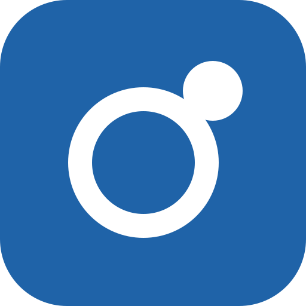
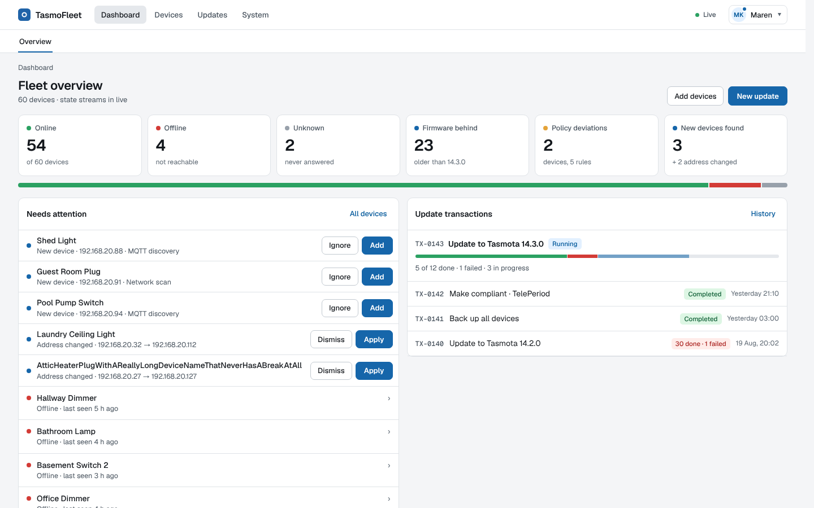
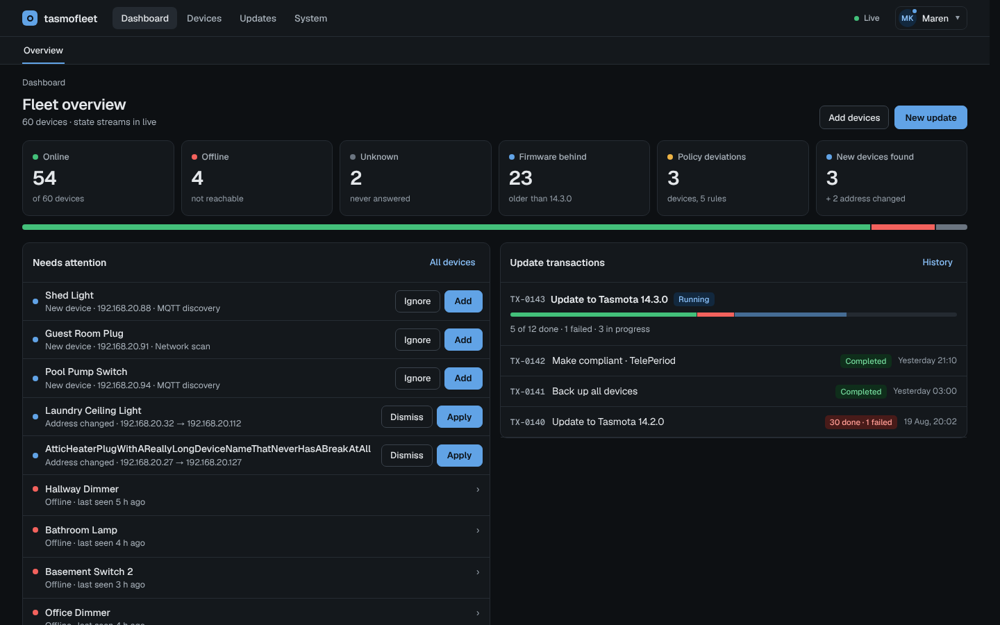
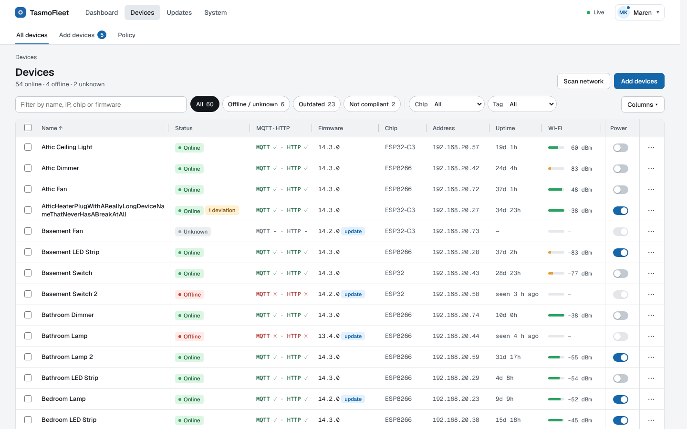
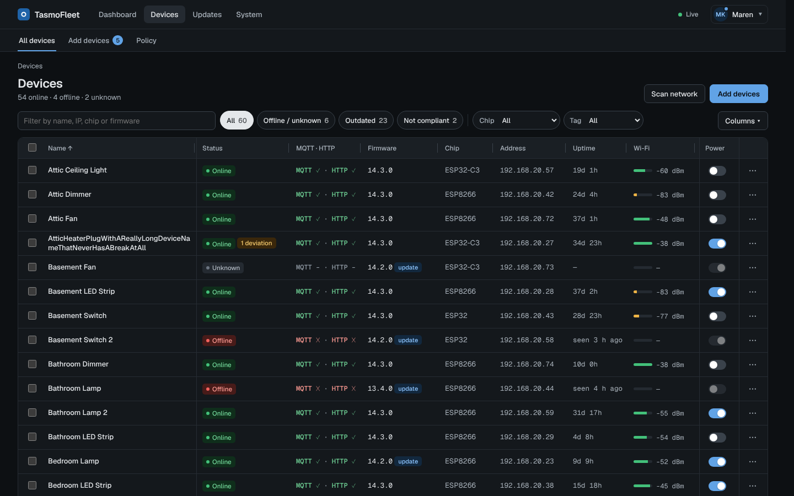

# TasmoFleet design prototype

A clickable UI prototype for **TasmoFleet**, a self-hosted web app that manages a fleet of
[Tasmota](https://tasmota.github.io/) devices in a homelab: status, firmware updates, backups,
a settings policy, discovery and users. TasmoFleet is the successor to TasmoAdmin.

**[Open the prototype](https://nofuturekid.github.io/tasmofleet-design/)**

Use the screen switcher and the Tweaks panel to move between screens, light and dark theme,
desktop and phone layout, and data states (normal, loading, empty, error).

|           | Light                                                                                                          | Dark                                                                                                         |
| --------- | -------------------------------------------------------------------------------------------------------------- | ------------------------------------------------------------------------------------------------------------ |
| Dashboard |  |  |
| Devices   |  |  |

## What this is

- A design reference, not the app. Everything is mock data: device names, people, addresses
  and domains (`lab.home`) are made up.
- It was generated with [Claude Design](https://claude.ai) (AI-assisted) from a feature brief,
  and is the visual target for the TasmoFleet web UI.
- The app itself (Go, server-rendered HTML with htmx) will be published separately.

## Files

- `index.html`: the self-contained prototype (it unpacks itself in the browser).
- `logo.svg`: the TasmoFleet logo.
- `screenshots/`: the dashboard and the device list at 1440 px, light and dark.

## Licenses

- Prototype: [MIT](LICENSE).
- Bundled fonts: Geist and Geist Mono, [SIL Open Font License 1.1](licenses/Geist-OFL.txt).
- Bundled React 18.3.1: [MIT](licenses/React-MIT.txt).
